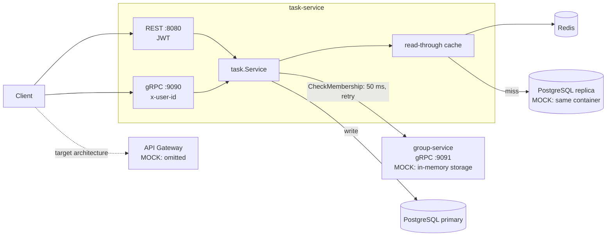
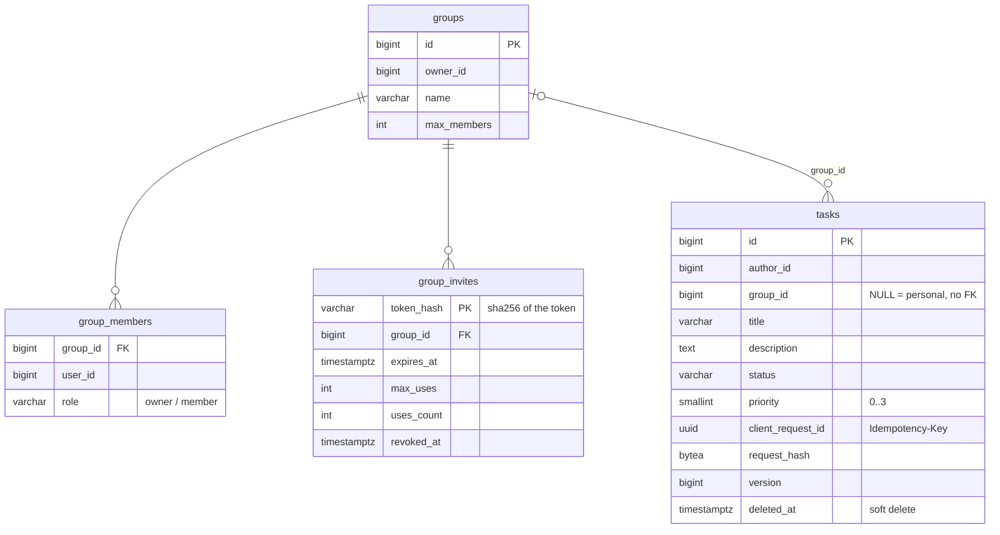
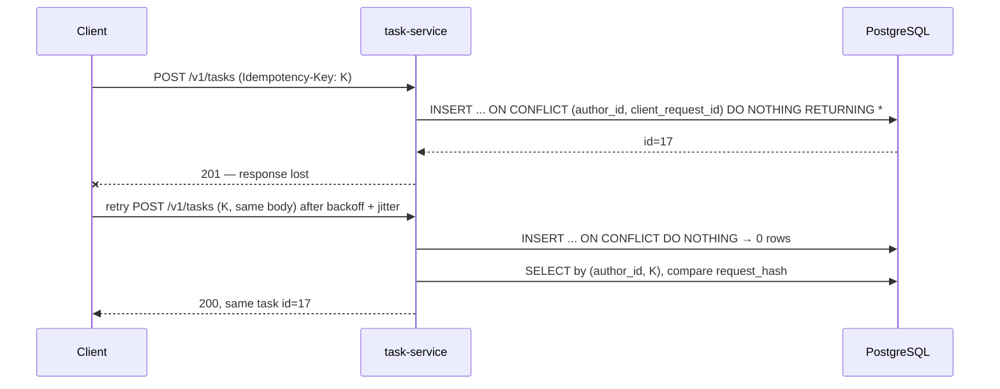
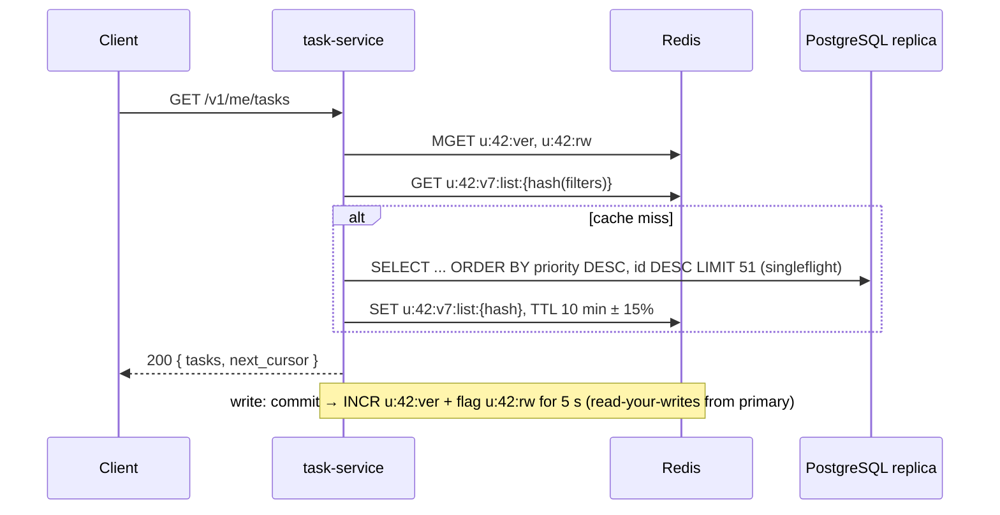
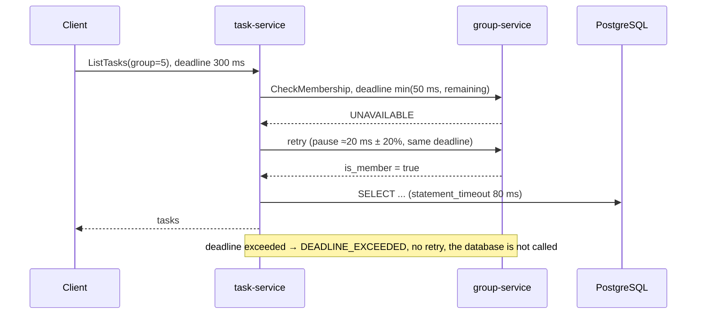

# Task Tracker

A task service: users create, update and delete tasks, sort them by priority, share them in groups
and invite people to a group with a link. Services talk to each other over gRPC, the public API is
REST/JSON, and a benchmark compares the two protocols.

Detailed report — [REPORT.md](REPORT.md), decisions — [docs/adr](docs/adr), mechanism walkthrough —
[docs/defense-notes.md](docs/defense-notes.md).

## Requirements

**Functional**
1. Create, update and delete a task; statuses `planned`, `in_progress`, `completed`
2. Sort tasks by priority
3. Groups: share tasks, join by an invite link

**Non-functional**
1. 2,000 RPS: 80% reads / 20% writes (mostly task creation)
2. 1M users
3. Latency p99 < 100 ms, availability 99.9%
4. Eventual consistency for replicas, read-your-writes for the author of a change

## Architecture



REST and gRPC call the same `task.Service`, so the benchmark compares only the transport and the
format. The cache is invalidated by an owner version: a write does `INCR u:{uid}:ver` (or `g:{gid}:ver`),
and every `u:{uid}:v{ver}:...` key of the old version stops being read at once.

## Entities



`tasks` is a PostgreSQL table (`migrations/0001_init.sql`) with a unique index on `(author_id, client_request_id)`.
Groups live in group-service: a MOCK in-memory store of the same shape (plus bans) behind the
`Repository` interface, so it can be swapped for PostgreSQL without touching the logic.

## API

The public API is REST/JSON; internal calls and the alternative client path use gRPC
(`proto/tasktracker/v1`). REST errors follow RFC 7807 (`application/problem+json`).

```
POST /v1/tasks
Authorization: Bearer <JWT>
Idempotency-Key: <uuid>
{ "title": "Write report", "description": "", "group_id": null, "priority": 3 }
→ 201 new | 200 retry with the same key | 422 same key, different body

GET /v1/tasks/{id}
→ 200 { "id", "author_id", "group_id", "title", "description", "status", "priority", "version", ... }
  ETag: "<version>"

GET /v1/me/tasks?status=planned,in_progress&sort=priority|created_at&limit=50&cursor=...
GET /v1/groups/{id}/tasks?status=&sort=&limit=&cursor=
→ 200 { "tasks": [...], "next_cursor": "..." } | 403 not a group member

PATCH /v1/tasks/{id}
If-Match: "<version>"
{ "status": "in_progress" }            (only the fields sent; "description": "" clears it)
→ 200 | 412 stale version

DELETE /v1/tasks/{id}
→ 204 (deleting again is also 204)
```

gRPC: `TaskService` — `CreateTask`, `GetTask`, `ListTasks`, `UpdateTask`, `DeleteTask`;
`GroupService` — `CreateGroup`, `GetInvitePreview`, `JoinByInvite`, `RemoveMember`, `TransferOwnership`,
`DeleteGroup`, `CheckMembership` (internal). In gRPC the user is passed in the `x-user-id` metadata
(MOCK: in the target architecture the gateway sets it after verifying the JWT).

## Flows

### Create a task (with a retry)



### Task list through the cache



### Group task: deadline and CheckMembership retry



## How to run

```bash
docker compose up --build -d                  # postgres, redis, group-service, task-service
export JWT_SECRET=change-me-dev-secret
TOKEN=$(go run ./cmd/devtoken -user 42)       # test JWT (MOCK auth service)

curl -X POST localhost:8080/v1/tasks -H "Authorization: Bearer $TOKEN" \
     -H "Idempotency-Key: $(uuidgen)" -d '{"title":"Write report","priority":3}'
curl "localhost:8080/v1/me/tasks?sort=priority" -H "Authorization: Bearer $TOKEN"
curl -X PATCH localhost:8080/v1/tasks/1 -H "Authorization: Bearer $TOKEN" \
     -H 'If-Match: "1"' -d '{"status":"in_progress"}'

grpcurl -plaintext -import-path proto -proto tasktracker/v1/task.proto -H "x-user-id: 42" \
     -d '{"scope":"SCOPE_PERSONAL","page_size":20}' localhost:9090 tasktracker.v1.TaskService/ListTasks
grpcurl -plaintext -import-path proto -proto tasktracker/v1/group.proto -H "x-user-id: 42" \
     -d '{"name":"Team"}' localhost:9091 tasktracker.v1.GroupService/CreateGroup

docker compose down                           # stop (data is not kept)
```

| Port | What |
|---|---|
| 8080 | task-service REST |
| 9090 | task-service gRPC |
| 9091 | group-service gRPC |
| 55432 | PostgreSQL (5432 on the host is often taken by a local PostgreSQL) |
| 6379 | Redis |

Fault injection into `CheckMembership`: `FAULT_UNAVAILABLE_RATE=0.2 FAULT_DELAY_MS=80 docker compose up -d group-service`.

Tests: `go test -race ./...` — integration tests start PostgreSQL and Redis with testcontainers
(Docker required). Code generation from `.proto`: `make gen` (generated code is committed to `gen/`).

| Module | What it is |
|---|---|
| [proto/tasktracker/v1](proto/tasktracker/v1) | gRPC contract: `task.proto`, `group.proto`, `common.proto` |
| [cmd/task-service](cmd/task-service) | REST :8080 + gRPC :9090 on top of one service layer |
| [cmd/group-service](cmd/group-service) | gRPC :9091, MOCK storage, fault injection |
| [cmd/devtoken](cmd/devtoken), [cmd/seed](cmd/seed) | dev JWT, data seeding |
| [bench/k6](bench/k6), [cmd/benchreport](cmd/benchreport) | k6 load test (gRPC vs REST) and the markdown report generator |
| [internal/model](internal/model) | domain types, pagination cursor, protobuf conversion |
| [internal/service](internal/service) | business logic: `task`, `group`, `auth` (JWT) |
| [internal/repository](internal/repository) | `task` (pgx, primary/replica), `group` (in-memory MOCK), `cache` (Redis read-through) |
| [internal/client/groupclient](internal/client/groupclient) | group-service client: 50 ms deadline, retry service config |
| [internal/transport](internal/transport) | `httpserver` (REST, RFC 7807, JWT) and `grpcserver` (TaskService, GroupService) |
| [internal/apperr](internal/apperr) | domain errors and a single mapping to gRPC codes and HTTP statuses |
| [migrations](migrations) | SQL migrations (goose), applied when task-service starts |

## Idempotency, timeouts, retries

| Mechanism | How |
|---|---|
| CreateTask | `Idempotency-Key` → `INSERT ... ON CONFLICT DO NOTHING`; a retry gets the same task (200), a different body gets 422 |
| UpdateTask | optimistic locking `WHERE version = ?` → 412; never retried automatically |
| DeleteTask | soft delete, deleting again succeeds |
| JoinByInvite | an existing member succeeds without using up the link |
| Timeouts | client 300 ms, CheckMembership 50 ms (never more than what is left of the incoming deadline), Redis 20 ms, PostgreSQL 80 ms |
| Retries | gRPC service config: 3 attempts, backoff 20 → 200 ms ×2 with jitter, `UNAVAILABLE` only, idempotent methods only |

Details — [REPORT.md](REPORT.md#idempotency-timeouts-retries).

## Measurements: gRPC vs REST/JSON

`./bench/run-all.sh` (~50 min) runs protocol {grpc, rest} × op {get, list, create} × concurrency
{1, 16, 64}, with and without the cache, and writes [bench/results/results.md](bench/results/results.md).
Cache on, latency in ms:

| op | conc | gRPC p50 | REST p50 | gRPC p99 | REST p99 | gRPC req/s | REST req/s | gRPC resp B | REST resp B |
|---|---:|---:|---:|---:|---:|---:|---:|---:|---:|
| get | 1 | 2.70 | 2.22 | 4.69 | 4.54 | 363 | 458 | 175 | 335 |
| get | 64 | 7.39 | 9.81 | 16.78 | 22.59 | 8,151 | 6,142 | 175 | 335 |
| list | 1 | 2.31 | 1.77 | 4.18 | 3.62 | 398 | 543 | 8,959 | 16,838 |
| list | 64 | 9.26 | 15.04 | 19.62 | 34.21 | 6,484 | 4,075 | 8,960 | 16,839 |
| create | 1 | 5.24 | 4.98 | 11.79 | 10.01 | 183 | 197 | 169 | 329 |
| create | 64 | 12.97 | 15.90 | 24.05 | 25.98 | 4,680 | 3,916 | 169 | 329 |

- A protobuf response is ~1.9× smaller than JSON.
- At concurrency 64 gRPC delivers 1.2–1.6× more req/s; at concurrency 1 REST is slightly faster.
- The 40–50 ms gRPC outliers come from Docker Desktop port forwarding: inside the docker network they
  are gone, and the gap at concurrency 1 shrinks to 5–8%.
- Every p99 is under 50 ms, so the p99 < 100 ms SLO holds.

The main matrix was measured while gRPC still verified a JWT. Methodology, full tables and the run
without port forwarding — [REPORT.md](REPORT.md#measurement-results).
